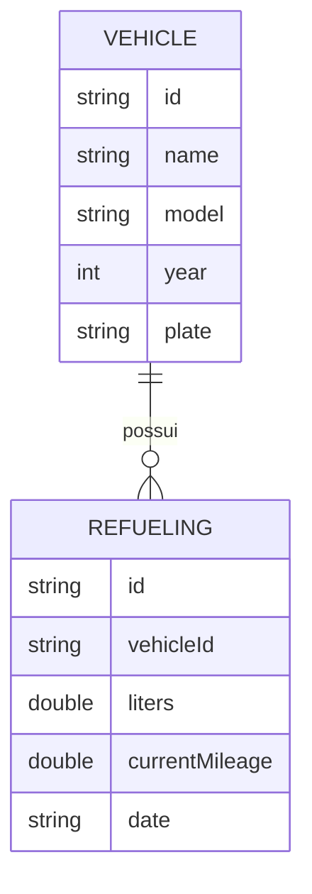

# ⛽ Controle de Abastecimento


## 📖 Sobre o projeto

O **Controle de Abastecimento** é uma aplicação desenvolvida com Flutter e Dart para facilitar o gerenciamento de veículos e o acompanhamento de seus abastecimentos.

O sistema permite cadastrar veículos, registrar a quantidade de combustível abastecida e a quilometragem atual, além de consultar o histórico de abastecimentos de cada veículo. A aplicação utiliza o Firebase Authentication para autenticação e o Cloud Firestore para armazenamento de dados em nuvem.

O projeto foi desenvolvido no contexto da disciplina de **Programação para Dispositivos Móveis**, com o objetivo de aplicar conceitos de desenvolvimento mobile, integração com serviços em nuvem e organização de código.

> **Código-fonte:** disponível na branch [`master`](https://github.com/joaogfzamarian/controle-abastecimento/tree/master).

## 🚀 Funcionalidades

### Autenticação
- Cadastro de usuários com e-mail e senha.
- Login e logout.
- Solicitação de recuperação de senha por e-mail.
- Tela de perfil com visualização do e-mail autenticado.

### Gerenciamento de veículos
- Cadastro de veículos com nome, modelo, ano e placa.
- Listagem de veículos com atualização em tempo real.
- Visualização dos detalhes de cada veículo.

### Controle de abastecimentos
- Registro da quantidade de litros abastecidos.
- Registro da quilometragem atual e da data do abastecimento.
- Associação de abastecimentos ao veículo correspondente.
- Consulta do histórico individual de abastecimentos em tempo real.

## 🛠️ Tecnologias utilizadas

| Tecnologia | Finalidade |
| --- | --- |
| Flutter | Desenvolvimento da interface e da aplicação |
| Dart | Linguagem de programação (SDK ^3.5.3) |
| Firebase Core | Inicialização dos serviços Firebase |
| Firebase Authentication | Autenticação de usuários |
| Cloud Firestore | Persistência de dados NoSQL e consultas em tempo real |
| Material Design | Componentes de interface |
| Git e GitHub | Versionamento de código |

## 📂 Estrutura do projeto

O código está organizado por responsabilidades, separando modelos de dados, serviços, telas e componentes de interface.

```text
lib/
├── auth/
│   ├── login.dart
│   ├── register.dart
│   └── reset_password.dart
├── models/
│   ├── refueling.dart
│   └── vehicle.dart
├── screens/
│   ├── home.dart
│   ├── profile.dart
│   └── vehicles/
│       ├── add_refueling.dart
│       ├── add_vehicle.dart
│       ├── edit_vehicle.dart
│       ├── history_page.dart
│       ├── vehicle_details.dart
│       ├── vehicle_history.dart
│       └── vehicle_list.dart
├── services/
│   ├── auth_service.dart
│   └── database_service.dart
├── widgets/
│   └── drawer_menu.dart
├── firebase_options.dart
└── main.dart
```

- **auth:** telas de autenticação.
- **models:** representação e conversão dos dados.
- **screens:** telas e fluxos de navegação.
- **services:** integração com Firebase Authentication e Cloud Firestore.
- **widgets:** componentes de interface reutilizáveis.

## 🗄️ Modelagem de dados

O Cloud Firestore utiliza duas coleções principais:

| Coleção | Campos |
| --- | --- |
| `vehicles` | `id`, `name`, `model`, `year`, `plate` |
| `refuelings` | `id`, `vehicleId`, `liters`, `currentMileage`, `date` |

Cada abastecimento é associado a um veículo por meio do campo `vehicleId`. A data é armazenada como uma string no formato ISO 8601.



## ⚙️ Como executar o projeto

### Pré-requisitos

- Flutter SDK compatível com Dart 3.5.3 ou superior dentro da série 3.x.
- Git.
- Android Studio e Android SDK, ou VS Code com extensões Flutter e Dart e ambiente Android configurado.
- Dispositivo ou emulador Android com API 32 ou superior, conforme a configuração atual do projeto.
- Conta e projeto próprios no Firebase.

### 1. Clone o repositório

```bash
git clone --branch master https://github.com/joaogfzamarian/controle-abastecimento.git
cd controle-abastecimento
```

### 2. Instale as dependências

```bash
flutter pub get
```

### 3. Configure o Firebase

Crie um projeto no [Firebase Console](https://console.firebase.google.com/), habilite o provedor de autenticação por e-mail e senha e crie um banco Cloud Firestore. Configure as regras de acesso adequadas para um ambiente de desenvolvimento isolado, sem liberar acesso público aos dados.

Instale a [Firebase CLI](https://firebase.google.com/docs/cli) e configure o FlutterFire:

```bash
firebase login
dart pub global activate flutterfire_cli
flutterfire configure
```

Selecione seu projeto Firebase e a plataforma Android. Confirme que `android/app/google-services.json` corresponde ao seu projeto e ao identificador Android `com.example.provaandreabastecimento`. O código atual inicializa o Firebase usando a configuração nativa; não utilize o banco original para testes sem autorização.

### 4. Execute a aplicação

```bash
flutter doctor
flutter devices
flutter run
```

As instruções priorizam Android, plataforma com configuração nativa identificada no repositório. A execução em outras plataformas pode exigir ajustes adicionais.

## 📈 Melhorias futuras

- [ ] Integrar a tela de edição de veículos ao fluxo de navegação.
- [ ] Implementar a persistência das alterações de perfil.
- [ ] Associar veículos aos usuários autenticados e revisar as regras de segurança do Firestore.
- [ ] Aprimorar validações e tratamento de erros.
- [ ] Implementar cálculo de consumo médio (km/L).
- [ ] Adicionar controle de despesas com combustível.
- [ ] Implementar testes automatizados das funcionalidades.
- [ ] Adicionar capturas de tela da aplicação à documentação.

## 👨‍💻 Autor

**João Furtado**

[](https://github.com/joaogfzamarian)

---

Projeto acadêmico desenvolvido para aplicar conhecimentos de programação mobile e integração com serviços em nuvem.
